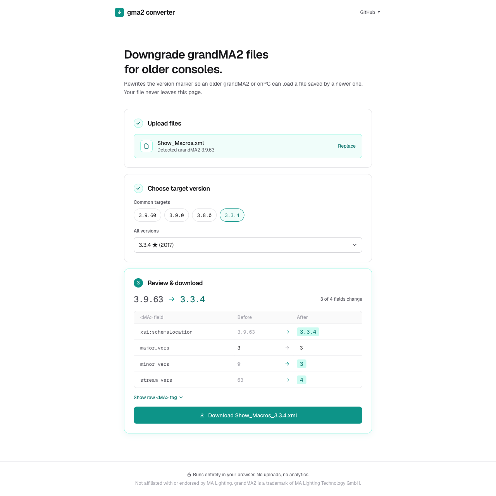
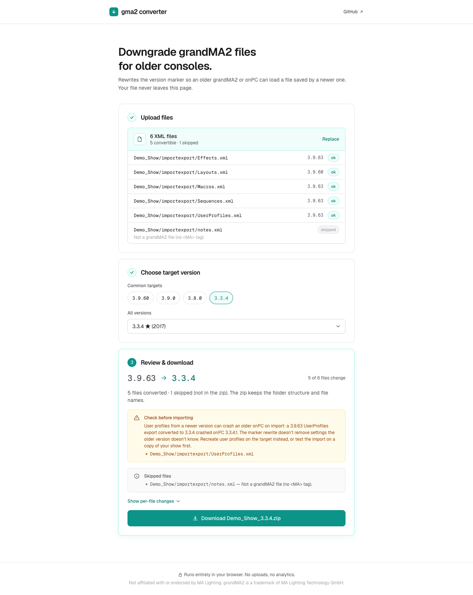

# gma2-version-convertor

A browser-based tool that **downgrades the version marker** of grandMA2 XML files, so an older
grandMA2 console or grandMA2 onPC can load files exported by a newer version.

**Use it:** https://gma2-converter.vercel.app

## Table of Contents

- [Overview](#overview)
- [Features](#features)
- [Verified on real grandMA2 software](#verified-on-real-grandma2-software)
- [Limitations](#limitations)
- [Getting Started](#getting-started)
- [Project Structure](#project-structure)
- [Contributing](#contributing)
- [Roadmap](#roadmap)
- [License](#license)

## Overview

A newer grandMA2 can load files from an older version, but not the other way round: an older
console refuses a newer file with "File is from a future software version". The check reads the
version stored in the file's `<MA>` tag. This tool rewrites that tag to a target version you choose,
so the file looks like a native export from the older software.

Everything runs **client-side**: files never leave your machine. This is enforced by a
Content-Security-Policy (`connect-src 'self'`), so the page cannot make network requests to any
other origin. You can verify this in your browser's DevTools.

Design decisions:

- **Precise string replacement, not parse-and-reserialize.** Only the opening `<MA>` tag changes.
  Every other byte (indentation, CRLF/LF, BOM, attribute order, comments) is preserved.
- **Downgrade only.** The source version is detected from the file; only older targets are offered.
- **Framework-free core.** The conversion logic lives in plain TypeScript modules under `src/lib/`
  with unit tests, separate from the Next.js UI.

See [`SPEC.md`](./SPEC.md) for the full specification and
[`docs/grandma2-versions.md`](./docs/grandma2-versions.md) for the version reference.

## Features

- **Single-file conversion.** Rewrites `xsi:schemaLocation` and `major_vers` / `minor_vers` /
  `stream_vers` in the `<MA>` tag to the target version. A field-by-field table shows what changes,
  with an optional raw before/after view of the tag. The result downloads with the target as a
  suffix (e.g. `Show_Macros_3.3.4.xml`), so your source file is never overwritten.

  

- **Whole show exports and batch conversion.** Pick or drop several files or a whole folder (e.g.
  the USB stick after "Export High Show"). Every grandMA2 `.xml` file inside is converted to one
  target and downloaded as a single zip (e.g. `Demo_Show_3.3.4.zip`) with the same folder structure
  and file names, ready for "Import Low Show". Each file is listed with its detected version and
  status:
  - Files already at or below the target are copied unchanged.
  - Files that aren't grandMA2 XML, can't be read, or have a duplicate path are skipped, with the
    reason shown.

  

- **Target selection.** Common targets (3.9.60, 3.9.0, 3.8.0, 3.3.4) as one-click buttons, a
  dropdown of known releases from 2.5.3 to 3.9.63, or a custom `major.minor.stream` triple. Versions
  not yet confirmed from a real export are marked "inferred".
- **Warnings before you import:**
  - Mismatched or incomplete version fields are flagged, naming the missing or non-numeric
    `*_vers` field.
  - User-profile exports get a "Check before importing" caveat (see
    [Limitations](#limitations)).
- **Strict UTF-8 input.** grandMA2 writes UTF-8. UTF-16/UTF-32 files, invalid UTF-8 and files that
  declare another encoding are rejected with a clear error instead of being silently re-encoded.

## Verified on real grandMA2 software

Converted files were imported on real **grandMA2 onPC 3.3.4.1, 3.7.0.5, 3.9.0.3 and 3.9.60.50**,
using 3.9.63.11 and 3.9.60 exports as sources. Each original was refused with "File is from a future
software version"; each converted file imported. A full 3.9.63 show export also re-imported into 3.3.4
with matching object counts.

- The version check reads only `major_vers` / `minor_vers` / `stream_vers`; the schema path is
  ignored.
- The files the tool downloads, both single files and batch zips, are byte-for-byte identical to the
  files onPC accepted.

Not yet tested on real software: the 3.8.0 target and any 2.x version. Details and the full matrix
are in
[`docs/grandma2-versions.md`](./docs/grandma2-versions.md#verified-end-to-end-on-grandma2-onpc).

## Limitations

A version-marker rewrite does not change the file's content:

- Elements only the newer version knows are **skipped** by the older one on import (e.g. newer cue
  timing options). Check the result on the target.
- **Don't import newer `UserProfiles`** into a much older version: a 3.9.63 user-profile export
  converted to 3.3.4 crashed onPC 3.3.4.1 (#19). Recreate profiles on the target instead.
- `.show.gz` files are a **binary** format, not XML, so they can't be converted. Export the show to
  XML on the newer version, convert the files, and import them into the older one.

## Getting Started

### Prerequisites

- Node.js >= 20.9 (required by Next.js 16)
- npm

### Installation

```bash
git clone git@github.com:chienchuanw/gma2-version-convertor.git
cd gma2-version-convertor
npm install
```

### Usage

```bash
npm run dev       # local dev server at http://localhost:3000
npm test          # run the unit tests (Vitest)
npm run lint      # ESLint
npm run build     # production build
```

There is no configuration: no environment variables, no server routes, no backend.

## Project Structure

```text
gma2-version-convertor/
├── src/
│   ├── app/
│   │   ├── layout.tsx       # Root layout and metadata
│   │   └── page.tsx         # Converter UI (upload, target, review & download)
│   ├── components/
│   │   ├── ui.tsx           # Shared UI pieces (callouts, diff table, icons)
│   │   └── batch.tsx        # Batch file list and batch review
│   └── lib/                 # Framework-free core, each module with a *.test.ts
│       ├── convert.ts       # Version detection and <MA> tag rewrite
│       ├── versions.ts      # Known release catalog
│       ├── encoding.ts      # Strict UTF-8 decode / encode
│       ├── caveats.ts       # Content warnings (user profiles)
│       ├── batch.ts         # Batch analysis, conversion and zip output
│       ├── drop.ts          # Folder drag-and-drop walking
│       └── latest.ts        # Guard that ignores superseded file reads
├── docs/
│   ├── grandma2-versions.md # Version reference and real-software test results
│   ├── progress.md          # Development status and milestones
│   └── screenshots/         # README images
├── next.config.ts           # Includes the Content-Security-Policy header
├── SPEC.md                  # Full specification
└── AGENTS.md                # Contributor and agent conventions
```

## Contributing

1. Cut a feature or fix branch from **`dev`** (the default branch).
2. Write a failing Vitest test for core changes first, then implement. Run `npm test`.
3. Open a pull request **into `dev`**.

`main` is production and auto-deploys to Vercel. `dev` is merged into `main` only for a tagged
release. Development status and milestones are in [`docs/progress.md`](./docs/progress.md);
conventions are in [`AGENTS.md`](./AGENTS.md).

## Roadmap

- Content-aware downgrade: remove or transform elements an older version can't handle.
- Traditional Chinese (zh-TW) interface.
- Reuse the conversion core in an MCP server or VS Code extension.

## License

This project does not specify a license yet.
